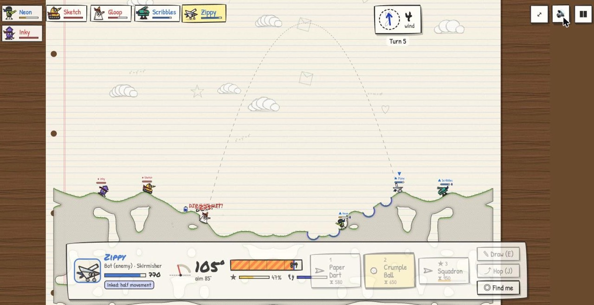

# Doodle War ✏️

A turn-based artillery game fought in the margins of a notebook. Pick a doodle, read the wind, set your angle
and power, and erase the other team off the page. Play against bots, pass one device around, or open an online
room and send a friend its 4-letter code.

Built with TypeScript, Phaser 4 and React, with a Colyseus server for online rooms. There are no art or sound
files: every sprite, paper texture, sound effect and music track is made in code when the game starts. The
only bundled assets are two open-source fonts, Patrick Hand and Permanent Marker.



## How this was built

I made this game with [Claude Code](https://claude.com/claude-code), Anthropic's AI coding agent, and the
history says so: the commits carry a `Co-Authored-By: Claude` line.

I decided what to make (a turn-based artillery game with a theme of its own), chose the notebook-doodle idea
and the order to build it in (offline first, online rooms after), and set the bar for how finished it should
feel. Claude wrote the code, the tests and these docs.

## Run it

```bash
pnpm install
pnpm dev          # the game at http://localhost:5173, the room server at ws://localhost:2567
pnpm build        # static site in apps/web/dist; upload that folder to any static host
pnpm preview      # serve the build locally to check it
pnpm check        # types, lint, tests and formatting; run it before committing
```

Needs Node 22 (22.12 or newer) or Node 24, and [pnpm](https://pnpm.io). The pnpm version is pinned in
`package.json`; run `corepack enable` once and the right one is fetched for you. pnpm is the only package
manager for this project: `pnpm-lock.yaml` is the one lockfile, and other managers' lockfiles are ignored by
git so a second one can never be committed.

In development the game looks for the room server on the same host at port 2567, so a phone on the same
Wi-Fi can open `http://<your computer's address>:5173` and join a room too.

## How to play

| Action                | Keyboard                              | Touch          |
| --------------------- | ------------------------------------- | -------------- |
| Walk                  | ← → or A D                            | ◀ ▶            |
| Aim                   | ↑ ↓ or W S                            | ▲ ▼            |
| Charge and fire       | Hold Space, release                   | Hold FIRE      |
| Pick a weapon         | 1 2 3 (3 is the special)              | Weapon buttons |
| Hop out of a crater   | J or Shift                            | ⤴              |
| Draw an ink line      | E, then drag                          | ✎, then drag   |
| Look around           | Drag, scroll to zoom, Tab for the map | Drag, pinch    |

Tips point these out during the first matches, and **How to play** on the title screen explains the rest.

### A match

- **Turn order runs on delay, not rounds.** Every action adds to the unit's delay, and the unit with the
  least delay goes next. Heavy weapons, walking far and drawing all push the next turn back, so a quick
  light shot can earn two turns in a row. The queue at the top shows who's next.
- **Wind** changes every turn and pushes every shot; light ones like the Paper Dart feel it most.
- **Terrain is destructible.** Explosions erase the pencil ground, and a unit standing over a crater falls
  in. Falling off the page is a knockout.
- **The special** (weapon 3) charges a little each turn, and faster when you deal or take damage.
- **Draw:** once per match, each unit can ink a short line of new ground, as a wall or a bridge.
- **Hop** spends part of the turn's walking to jump out of a crater or onto a ledge.
- **Pickups** parachute in every few turns: a **Band-Aid** heals 250, a **Gold Star** adds 50 to the
  special, an **Ink Refill** gives back the Draw. Walk over one to take it. A blast near one pops it.
- **Sudden death** starts on turn 40: every hit does 1.5× damage and the wind gets stronger.

### The doodles

| Doodle       | HP   | Shots                                                                          | Special                                  |
| ------------ | ---- | ------------------------------------------------------------------------------ | ---------------------------------------- |
| Pencil Tank  | 1000 | Graphite Shell; Twin Lead, one shell short and one long                        | Sharpener: tunnels in, then goes off big |
| Ink Squid    | 950  | Ink Blot, a wide splash; Splatter, which splits in three at the top            | Ink Storm: a rain of seven drops         |
| Paper Plane  | 880  | Paper Dart, a glider the wind pushes hard; Crumple Ball, which barely feels it | Squadron: three darts in formation       |
| Stapler Mech | 1150 | Staple, fast and flat; Rubber Band, which bounces twice                        | Staple Storm: five staples in a burst    |

The Ink Squid's ink is sticky: whoever it hits walks half as far on their next turn.

There are five maps (Margin Hills, Sticky Notes, Coffee Ring, Spiral Tower and Paper Bridges), and **Remix**
reshuffles a map's details for a new layout. Matches run from 1v1 to 3v3, and bots come in three levels.

## Online play

**Play Online** on the title screen creates a room and shows its code, such as `KQ7P`, and an invite link
(`?room=KQ7P`) that joins it directly. The host picks the map and the teams, and can fill empty seats with
bots. A player whose connection drops has 45 seconds to come back, and reloading the page rejoins the same
seat.

The server runs the match. Clients send what the player does (walk, aim, fire, draw, hop, skip), and the
server runs the rules and sends back what happened. Walking is the one exception: it's predicted on the
client so your own doodle moves without waiting for the network. Walking works in whole pixels, so the
server arrives at the same spot.

## Putting it online

The game and the room server are hosted separately. The game is a static site and works on its own: bots
and pass-and-play need no server. The room server is only needed for **Play Online**.

### The game

`pnpm build` writes a static site to `apps/web/dist`, which any static host can serve. Where the host builds
for you, the build command is `pnpm build` and the output folder is `apps/web/dist`. It uses relative
paths, so it works at the top of a domain or in a subfolder such as `example.com/doodle-war/`.

The room server's address is fixed at build time. Set `VITE_SERVER_URL` to it when building, such as
`VITE_SERVER_URL=wss://rooms.example.com pnpm build`. A build without it still plays offline, and its online
menu says online play isn't set up for that build.

The build is an installable web app with a service worker: once loaded, it plays offline against bots. Pages
are fetched network-first, so a new release shows up on the next visit; the hashed files in `assets/` are
cached for good. The link preview uses `og.jpg`, and some sites only read an absolute address, so set
`og:image` in `apps/web/index.html` to the full URL once the address is known.

### The room server

`apps/server/Dockerfile` builds an image that listens on `$PORT` (2567 if unset). Any host that runs a
container and passes WebSockets through can run it. Build it from the repository root:

```bash
docker build -f apps/server/Dockerfile -t doodle-war-server .
docker run -p 2567:2567 doodle-war-server
```

Rooms live in memory, so a restart ends the matches in progress. The server keeps nothing on disk, and one
instance is enough: matches are short and small.

**What it costs to run.** `pnpm --filter @doodle/server bench -- --rooms 20` plays 20 matches at once
against an in-process server, each a scripted player against a server bot, and reports what they used. On
a laptop:

| Measured                | Result                                         |
| ----------------------- | ---------------------------------------------- |
| An average match        | 91 s and 14 turns                              |
| Memory                  | about 6 MB per match in progress               |
| CPU                     | 0.9 s per match, most of it the bot's planning |
| Sent by the server      | about 40 KB per player per minute              |

The Docker image idles at about 80 MB. Memory is the limit, so an instance with 512 MB holds dozens of
matches at once. The bench's own clients run in the same process, so its figures are a little high.

## How the code is organised

A pnpm workspace with three packages:

```
packages/sim    The rules: terrain, shots, turn order, pickups, bots, and the online protocol
apps/web        The game: Phaser scene, React menus and HUD, the art and the audio
apps/server     The room server: a Colyseus room that runs the same rules for online matches
```

| Layer          | Choice                                                     |
| -------------- | ---------------------------------------------------------- |
| Rendering      | [Phaser 4](https://phaser.io) (WebGL)                      |
| Menus and HUD  | React 19, over the canvas                                  |
| Art            | [rough.js](https://roughjs.com) and Canvas 2D, drawn at boot |
| Rules          | `@doodle/sim`, plain TypeScript with no DOM                |
| Online         | [Colyseus 0.18](https://colyseus.io)                       |
| Build and test | Vite 8, Vitest, TypeScript 7                               |

### How it works

- **One set of rules.** `@doodle/sim` runs in the browser for offline play and on the server for online
  matches, so the rules live in one place and are tested without a browser. It draws its randomness from a
  seeded generator, never `Math.random`, so a seed replays the same match.
- **The terrain is a byte per pixel:** empty, pencil or ink. It decides every collision. The renderer keeps
  its own copy, applies the same crater and ink operations in step with the shot's animation, and redraws
  only the 256 px tiles that changed. The pencil shading comes from each pixel's distance to the nearest
  edge, so it reads as hatching and doesn't band under overhangs.
- **A shot is worked out in full the moment it's fired.** The sim runs it at a fixed 60 steps a second,
  moving no more than about a pixel between collision checks, and returns the projectiles' paths and a
  timeline of what happens: explosions, craters, damage, falls, pickups. The game then plays that timeline
  back. Online, the server sends the result rather than having each browser run the shot, so browsers
  whose `Math.sin` differs in the last digit can't drift apart.
- **Online clients copy the server.** The terrain is sent once, run-length encoded (about 50× smaller), and
  stays identical byte for byte because craters are whole-pixel operations.
- **Bots search.** They try a coarse grid of angle, power, weapon and facing as dry-run shots, refine the
  best few, and then miss on purpose by an amount that depends on their level. They read the wind exactly;
  the miss stands in for skill. They also weigh walking over to a pickup. In the browser this runs in a
  Web Worker, so the game keeps animating while a bot thinks.

### Things to know before changing it

- **Change rules in `packages/sim`,** never in the game or the server, and keep it free of the DOM,
  Phaser and `Math.random`. Both sides import it as TypeScript source; there's no build step for it.
- **Change the terrain only through `Terrain`'s operations** (`carveCircle`, `fillCircle`, `fillThickLine`).
  Online clients replay the same operations to stay identical to the server.
- **The bot worker rebuilds the game state from a message** (`PlanRequest` in `apps/web/src/game/bot.worker.ts`).
  A new field on `GameState` that the bots should read has to be added there too.
- **Messages between the game and the server are typed in one place,** `packages/sim/src/protocol.ts`.
- **Phaser textures outlive the images that use them.** `TerrainView.destroy()` destroys its images first;
  removing a texture that an image still shows breaks rendering.

## Tests

`pnpm test` runs 37 tests:

- **`packages/sim/test/sim.test.ts`:** terrain operations, every map, the turn flow (the same seed replays
  the same match, delay decides who's next, craters, falls, Draw), the protocol's encoding, pickups, the
  hop, and the bots: that one plans quickly on a real map, and that a hurt one walks over to a Band-Aid.
- **`packages/sim/test/fullmatch.test.ts`:** a whole bot-against-bot match on each of the five maps, which
  has to end with a winner.
- **`apps/server/test/room.test.ts`:** a real server on a local port. Two clients make a room, start a 1v1,
  check that the terrain they receive is identical, walk and fire. Others fill a team with a bot and check
  that it plays its own turn, that no one gets into a room without its code, and that a client flooding
  the room with messages is dropped.

## Checks and security

**Every pull request** is checked by GitHub Actions (`.github/workflows/ci.yml`):

- **Check** installs exactly what `pnpm-lock.yaml` lists, then runs `pnpm check` (types, lint, the tests
  above and formatting) and `pnpm build`. It runs again on `main` after each merge.
- **Dependency review** fails if the pull request adds or upgrades a package with a known vulnerability of
  moderate severity or worse.

`main` takes a pull request only once both checks pass.

**Dependencies** are kept current by Dependabot (`.github/dependabot.yml`), for the packages, the GitHub
Actions and the server's Docker image. A fix for a known vulnerability arrives as a pull request as soon as
the advisory is out. Routine updates come once a month, and only once a release is a week old: a hijacked
release is usually found and pulled before then. The actions in the workflows are pinned to commits.

**pnpm** has guards of its own. It runs no install scripts: `allowBuilds` in `pnpm-workspace.yaml` turns
down the two packages that ask, and both work without them. And `trustPolicy` there refuses a release
published with less proof of origin than the ones before it, which is how most hijacked npm packages have
shipped.

**The room server** trusts nothing a client sends. It acts only for the player whose unit's turn it is,
keeps power, walking and the angle within what the rules allow, fires a special only once it's charged,
and runs every shot itself. Rooms are private, so the 4-letter code is the only way in, and a client that
sends more than 120 messages a second is dropped. The Docker image runs the server as an unprivileged user.
It stores nothing: names live in memory for as long as the room does.

**On GitHub**, these are set in the repository's settings, not in any file:

| Setting                         | Value                                                                               |
| ------------------------------- | ----------------------------------------------------------------------------------- |
| Merging                         | merge commits only; the branch is deleted once merged                               |
| Rule on `main`                  | changes only through a pull request whose checks pass; no force-push, no deletion   |
| Actions                         | GitHub's own actions only, pinned to a commit; a pull request from a fork waits for approval |
| Dependabot                      | alerts and security updates                                                         |
| Code scanning                   | CodeQL, default setup                                                               |
| Secret scanning                 | on, with push protection: a push that contains a key or a token is refused          |
| Private vulnerability reporting | on, as `SECURITY.md` explains                                                       |

The owner can still merge a pull request past a failing check, for an emergency such as an outage of
GitHub Actions, but nobody can push to `main` directly.

To report a vulnerability, see [`SECURITY.md`](SECURITY.md).

## License

Copyright © 2026 Farul Ivan. All rights reserved.

The code is public so it can be read and its history followed, but it isn't open source. Beyond what
GitHub's terms allow for every public repository (viewing it, and forking it on GitHub), no permission is
given to copy, change or redistribute any part of it.

The fonts come through their `@fontsource` packages: Patrick Hand under the SIL Open Font License 1.1,
and Permanent Marker under the Apache License 2.0.
